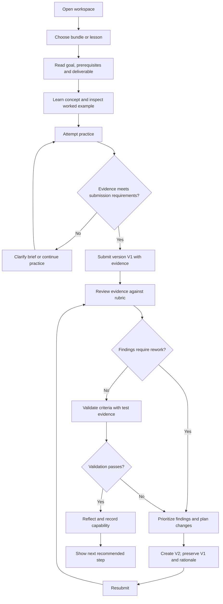
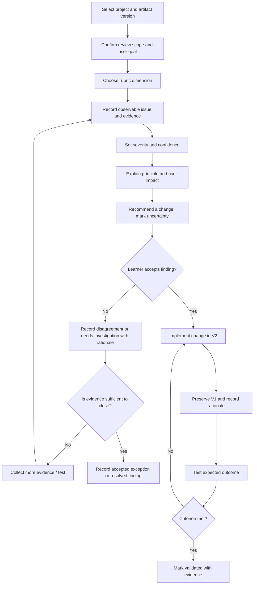

# HACHARA User Journey, Process Flow & Task Flow Maps v1.0

**Status:** Proposed flows based on current product contracts; route and persistence details require runtime verification.  
**Audience:** product, UX, curriculum, engineering, QA and automation.

## 1. Product-level end-to-end journey
| Stage | User goal | User action | System response expected | Evidence/state | Likely friction | Success measure |
|---|---|---|---|---|---|---|
| Discover | Find the right starting point | Opens workspace/catalog, explores bundles | Explains audience, outcomes, effort, prerequisites and next step | Chosen bundle/lesson | Too many entry points; unclear route | Learner selects a suitable lesson without help |
| Orient | Understand why this lesson matters | Reads outcome and context | Shows goal, example, constraints and deliverable | Lesson started | Theory without application | Learner can restate goal |
| Learn | Understand concept | Reads/watches example and checks explanation | Provides chunked explanation, example and comprehension check | Lesson state | Too much content or jargon | Learner explains concept in own words |
| Practice | Apply concept safely | Attempts guided activity then independent task | Gives constraints, expected output and success criteria | Draft artifact | Blank-canvas anxiety | Learner produces an attempt |
| Build | Apply to real project | Uses Studio/tool and project context | Preserves goal, target user, current phase and references | Project/artifact V1 | Context loss across tools/pages | Learner can connect output to user need |
| Submit | Share evidence for review | Adds link/screenshot/notes/test record | Checks required evidence and confirms version | Submitted | Unclear evidence requirement | Valid evidence is attached |
| Review | Understand strengths/gaps | Runs or requests structured review | Shows evidence, confidence, severity, impact and recommendation | Findings | Vague or overconfident critique | Learner understands next action |
| Rework | Improve work | Chooses finding, revises and explains why | Preserves V1 and records V2/change rationale | Resubmitted V2 | Feedback overload; lost original | Change is traceable to finding |
| Validate | Check if change worked | Runs test against criterion | Compares expected vs observed result | Validated or needs rework | “Looks better” substituted for evidence | Criteria have evidence-backed result |
| Reflect | Consolidate learning | Notes decision, limitation and next skill | Prompts concise reflection and transfer | Reflection | Reflection feels like busywork | Learner can name what changed and why |
| Progress | See capability and next step | Opens progress view | Shows states derived from evidence, not clicks alone | Capability record | Demo values mistaken for actual progress | Learner trusts status and knows next action |
| Share | Present work if desired | Creates case study or shares selected artifact | Shows provenance and lets learner control visibility | Portfolio/share artifact | Accidental disclosure; unsupported claims | Case study is credible and privacy-controlled |

## 2. Primary task flow — complete a lesson into demonstrated capability

## 3. Process flow — design review and rework

## 4. Task flow — discover and start the right lesson
1. Enter from workspace, catalog or bundle dashboard.
2. Identify goal/topic; filter only by metadata that exists and is accurate.
3. Open lesson; verify title, outcome, level/prerequisites and deliverable.
4. Decide to start, resume or choose prerequisite.
5. Enter lesson with source/return link preserved.
6. Complete example/comprehension check and practice.
7. Save/submit evidence; see explicit status and next step.

**Failure/recovery branches:** no matching lessons → explain and clear filters; missing metadata → flag for correction rather than fabricate; broken route → safe fallback plus reportable route; incomplete work → resume from saved checkpoint if actually supported.

## 5. Task flow — review a submitted artifact
1. Select project, task and exact version.
2. Confirm target user, goal, viewport/context and review scope.
3. Choose review dimension (UX, UI, accessibility, interaction, visual quality).
4. Record observation before interpretation.
5. Attach evidence (screen, artifact, test result or principle reference).
6. Record confidence and severity; explain impact.
7. Provide an actionable recommendation and expected result.
8. Learner accepts, disputes with rationale or requests investigation.
9. If accepted, implement a traceable V2; retest.
10. Close only when evidence supports validation or an explicit exception is recorded.

## 6. Task flow — resume work after interruption
1. Re-enter project/lesson.
2. Load last saved state, version and pending action (only if persistence is verified).
3. Show incomplete/unsaved work status honestly.
4. Restore the correct artifact and context.
5. Continue, recover from backup or explain that the previous state was not saved.
6. Do not silently create duplicate submissions or mark the task completed.
7. Verify progress summary after saving.

## 7. Navigation and context contract
Every cross-page handoff should preserve as many supported values as available: project ID/name, target user, task/goal, selected lesson/bundle, artifact/version, current workflow state, open findings, return destination and source route. If state is currently local-only, document its limits; do not promise cross-device continuity.

## 8. State transition flow
Current contract in `data/workflow-state-machine.json`:
- `not-started → in-progress → submitted → under-review`
- `under-review → needs-rework → resubmitted → under-review`
- `under-review → ready-for-validation → validated`
- `ready-for-validation → needs-rework` when validation fails.
Guards: required evidence at submit; review context before review; V1 preserved/V2 recorded at resubmission; findings resolved or explicitly accepted with evidence before validation; criteria satisfied before validated.

## 9. Error, empty and edge states to design/test
- No project or lesson selected.
- No lessons match a filter.
- Missing/broken lesson metadata or route.
- Empty evidence and invalid artifact URL.
- Artifact inaccessible or wrong version selected.
- Review finding without supporting evidence.
- Conflicting findings or low-confidence interpretation.
- Storage unavailable, malformed or cleared.
- Refresh/navigation while work is unsaved.
- Duplicate submission and repeat click.
- Validation fails after an apparent visual improvement.
- Mobile viewport, keyboard-only and screen-reader path.
- Learner chooses not to share an artifact.
- External tool unavailable or UI differs from instruction.
- User disagrees with review or asks for a second opinion.

## 10. Journey measurement plan
Measure task success, time-on-task, abandonment stage, wrong turns, assistance requests, evidence completeness, review comprehension, rework completion, validation pass/fail, resume success and user trust. Report sample size/context and distinguish behavioural observations from self-reported confidence. Do not treat page views as skill mastery.

## 11. Runtime validation checklist
- [ ] Test each flow in Classic and Modern entry points where relevant.
- [ ] Confirm all route targets exist and the correct view opens.
- [ ] Confirm project/lesson context survives every handoff.
- [ ] Test every allowed and forbidden state transition.
- [ ] Refresh at each major stage and record actual persistence behaviour.
- [ ] Confirm V1 remains accessible after V2.
- [ ] Confirm validation requires evidence and progress updates accurately.
- [ ] Test keyboard, narrow viewport and error/empty states.
- [ ] Capture screenshots/logs with browser and commit version.
- [ ] Separate automated assertions from manual usability/device acceptance.
